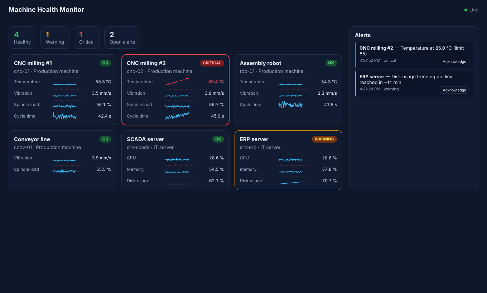

# Machine Health Monitor

**Real-time monitoring of production machines and IT servers, with automatic anomaly detection and early warnings.**

Built by Dhia Kanzari for teams that run automation equipment *and* the servers behind it (SCADA, ERP): one screen that shows what is healthy, what is drifting, and what needs action now — before a breakdown stops the line.



## What it does

- **Live telemetry** for each asset: temperature, vibration, spindle load and cycle time for machines; CPU, memory and disk for servers. Streamed to the browser with Server-Sent Events.
- **Three kinds of detection**, each tuned for a different failure pattern:
  - **Hard limits** → `critical` (e.g. temperature ≥ 85 °C).
  - **Learned baseline** (EWMA mean/variance per metric) → `warning` when a reading is ≥ 4σ away from that machine's normal behaviour. Catches problems even when they stay under the hard limit, such as early bearing wear.
  - **Trend forecasting** (least-squares slope) → `warning` *before* the limit is hit, e.g. *"Disk usage trending up: limit reached in ~14 min"*.
- **Alert hygiene**: per-metric cooldown so one fault doesn't flood the feed; acknowledge button; anomalies don't contaminate the learned baseline.
- **Fault simulator** for demos: bearing wear, overheating, CPU spikes and disk leaks appear every ~90 s (or double-click a machine).

## Run it

```bash
cd server && npm install && npm start          # http://localhost:4100 (serves the built dashboard)
cd client && npm install && npm run dev        # dashboard dev server on :5173
cd server && npm test                          # detector + API tests (node:test)
```

To plug in real equipment, replace `Plant.step()` with readings from OPC UA / Modbus / MQTT for machines and from Prometheus / SNMP / `node_exporter` for servers: the `Monitor` only needs `monitor.ingest(machineId, { metric: value })`.

## API

| Method | Endpoint | Description |
|---|---|---|
| GET | `/api/machines` | assets with status (`ok` / `warning` / `critical`) and latest readings |
| GET | `/api/machines/:id/history` | last 2 minutes of readings |
| GET | `/api/alerts` | alert feed |
| POST | `/api/alerts/:id/ack` | acknowledge an alert |
| GET | `/api/stream` | Server-Sent Events: `metrics` every second, `alert` when raised |
| POST | `/api/machines/:id/fault` | demo: inject a fault |

## Tech

Node.js 22 · Express · Server-Sent Events · React 19 · Vite · node:test. No database or chart library needed: sparklines are plain SVG.

## Structure

```
server/src/detector.js   EWMA detector, trend forecast, alert manager
server/src/simulator.js  simulated machines/servers with realistic faults
server/src/server.js     REST API + SSE stream
client/src/main.jsx      dashboard
```

MIT — Dhia Kanzari
